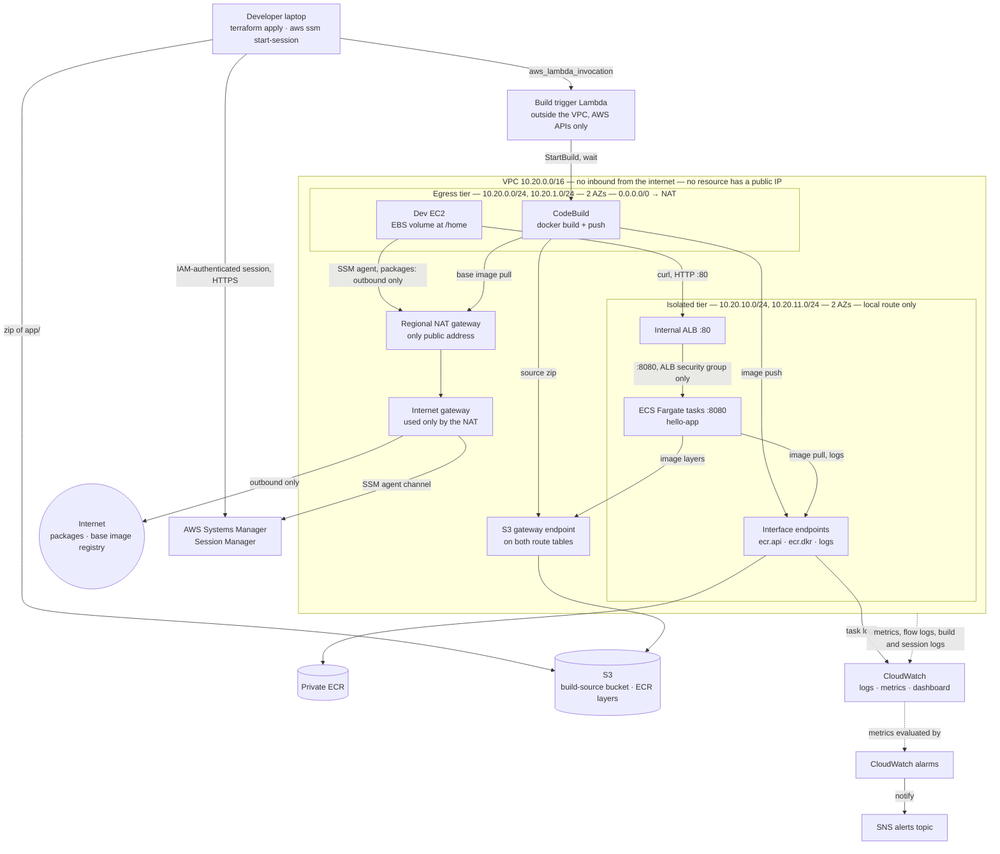

# Architecture

The developer laptop runs Terraform and the AWS CLI; it never opens a
connection into the VPC. The internet gateway is attached to the VPC only
because a NAT gateway requires one; only the NAT uses it, and no route table
points at it.

## How each private resource is reached

| Resource | Reached by | Path |
|---|---|---|
| Dev EC2 | Developers | SSM Session Manager. The agent opens an outbound connection through the NAT; the instance has no inbound rules |
| App (ALB + tasks) | Anything inside the VPC | Private DNS name of the internal ALB, HTTP :80, security group limited to the VPC CIDR |
| ECS tasks | The ALB only | Security-group reference on :8080 |
| ECR, CloudWatch Logs, S3 | Tasks in the isolated tier, CodeBuild | VPC interface endpoints (`ecr.api`, `ecr.dkr`, `logs`) and the S3 gateway endpoint |
| CodeBuild | The trigger Lambda | CodeBuild `StartBuild` API; the build runs in the egress subnets and pulls its base image through the NAT |
| Trigger Lambda | Terraform | `aws_lambda_invocation` (Lambda Invoke API); the function is not attached to the VPC |
| Internet | Egress tier only | NAT gateway, outbound only |

## Monitoring

Built by `modules/monitoring` and friends:

- **Alarms (8)** to the `<name>-alerts` SNS topic, symptoms first: unhealthy ALB targets, target 5xx, running tasks below desired, ECS CPU and memory above 80%, dev box status check, NAT port-allocation errors, failed CodeBuild builds. Set `alert_email` to receive them.
- **Dashboard** named by the `dashboard_name` output: requests and errors, p95 latency, CPU and memory, NAT traffic, alarm state.
- **Logs:** app, build, trigger Lambda and VPC flow logs (all traffic) in CloudWatch with 14-day retention by default, SSM session logs with 30 days, and Container Insights on the ECS cluster. Only sessions started with the custom session document (what `ssm_command` uses) are logged to the session log group.

At larger scale this would not be per-environment CloudWatch alarms written by hand. Metrics and alarms would be generated from shared module defaults per service and fed to one central account (CloudWatch cross-account observability, or Prometheus/Grafana or Datadog). Alerts would route by severity and ownership through an on-call tool rather than one SNS topic, and alarms would be tied to SLOs (error rate and latency burn) instead of fixed thresholds. Flow logs and session logs would go to a central log account with longer retention.
