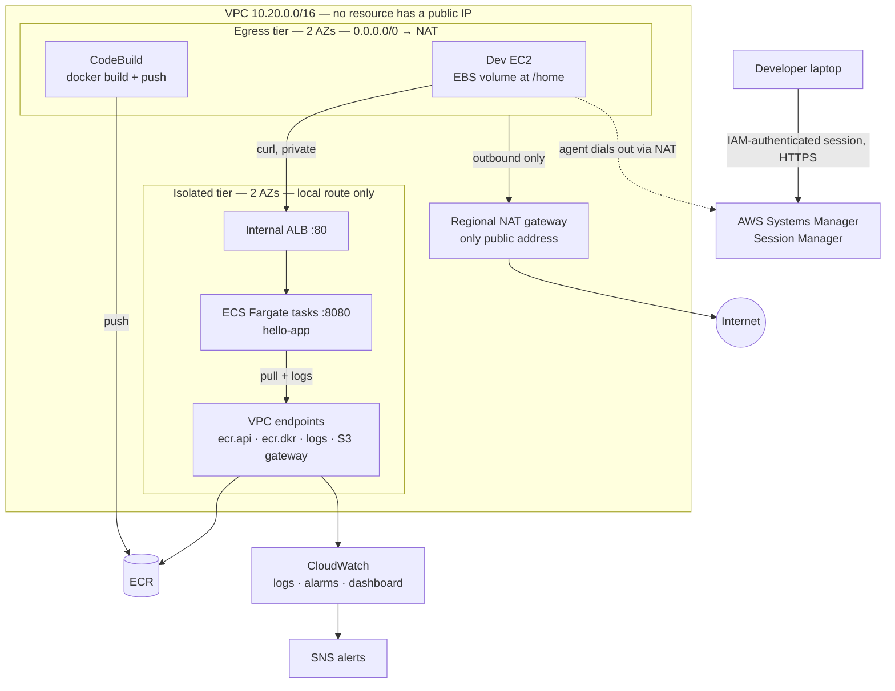

# Architecture

Not drawn: the trigger Lambda that starts the CodeBuild build runs outside the
VPC and only calls the CodeBuild and ECR APIs. The internet gateway exists only
because a NAT gateway requires one; no route table points at it.

## How each private resource is reached

| Resource | Reached by | Path |
|---|---|---|
| Dev EC2 | Developers | SSM Session Manager. The agent opens an outbound connection; the instance has no inbound rules |
| App (ALB + tasks) | Anything inside the VPC | Private DNS name of the internal ALB, HTTP :80, security group limited to the VPC CIDR |
| ECS tasks | The ALB only | Security-group reference on :8080 |
| ECR, CloudWatch Logs, S3 | Tasks in the isolated tier | VPC interface and gateway endpoints |
| Internet | Egress tier only | NAT gateway, outbound only |
